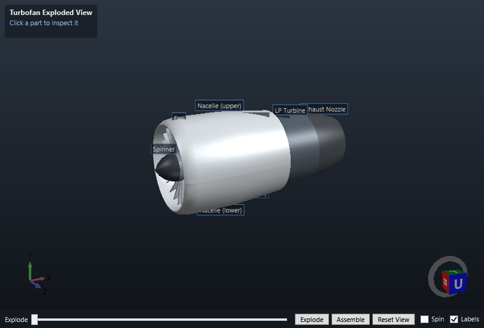
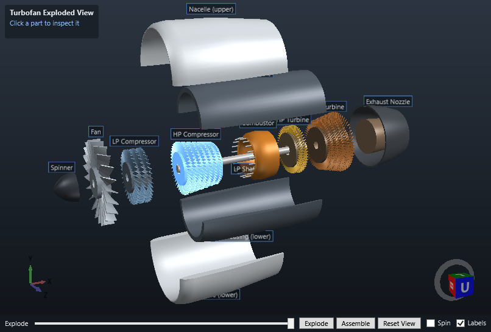

# Turbofan Exploded View Control

A VeriStand screen custom control that shows an interactive 3D exploded view of a high bypass turbofan engine. It is built with [HelixToolkit.Wpf](https://github.com/helix-toolkit/helix-toolkit) and does not bind to any channels. All interaction happens locally in the view.

| Assembled | Exploded |
| --- | --- |
|  |  |

## Features
* Procedurally generated engine with no external model files. Parts: spinner, fan, LP compressor, HP compressor, combustor with fuel nozzles, HP turbine, LP turbine, exhaust nozzle and plug, LP shaft, split nacelle and split core casing.
* **Explode** slider plus animated **Explode** / **Assemble** buttons. Core parts spread along the engine axis, and the nacelle and core casing open vertically in nested layers.
* **Spin**: the LP and HP spools rotate at different speeds.
* **Labels**: billboard part names that follow the parts as they move.
* Click a part to highlight it and show its description. Right-drag to rotate, use the mouse wheel to zoom, and use the view cube or **Reset View** to restore the camera.

## Structure
The project follows the MVVM pattern described in [ARCHITECTURE.md](../VeriStandCustomControls/ARCHITECTURE.md):

| File | Role |
| --- | --- |
| [EngineExplodedViewModel.cs](EngineExplodedViewModel.cs) | `ICustomVeriStandControl` palette export plus the `VisualModel` used for serialization. |
| [EngineExplodedViewViewModel.cs](EngineExplodedViewViewModel.cs) | `VisualViewModel` that creates the view. |
| [EngineViewModelProvider.cs](EngineViewModelProvider.cs) | Registers the model/view model pair with the screen editor. |
| [EngineNamespaceSchema.cs](EngineNamespaceSchema.cs) | Unique serialization namespace and version of this plugin. |
| [EngineExplodedViewControl.xaml](EngineExplodedViewControl.xaml) | The view: `HelixViewport3D` plus toolbar. Independent of VeriStand. |
| [EngineGeometryFactory.cs](EngineGeometryFactory.cs) | Builds the engine meshes (revolved profiles and twisted blade rings) with Helix `MeshBuilder`. |
| [EngineComponent.cs](EngineComponent.cs) | One engine part with its explode offset, spin transform and highlight state. |

## Building and Deploying
1. Update `VeriStandDir` and `VeriStandPluginDir` in [EngineExplodedView.csproj](EngineExplodedView.csproj) if your VeriStand version or paths differ.
1. Build the project. NuGet restores `HelixToolkit.Wpf` automatically.
1. After the build, the plugin assembly **and** `HelixToolkit.Wpf.dll` are copied to `VeriStandPluginDir` (skipped if the folder does not exist). VeriStand needs both files in the plugin folder.
1. Launch VeriStand, open a screen and drop **3D Views > Turbofan Exploded View** from the palette.
